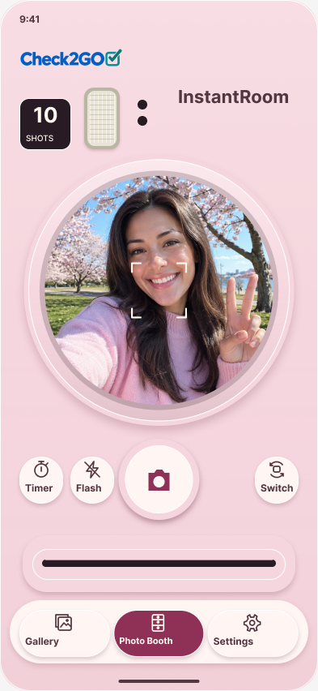

# InstantRoom — Insta Style Design System 1.0

**Insta Style Design System 1.0 — Pending Product Design Approval**

[Editable native Figma / Pink main](https://www.figma.com/design/vKttBpSwn9wfSg9aVB01NG?node-id=3-2) · [Interactive review prototype](https://www.figma.com/proto/vKttBpSwn9wfSg9aVB01NG/InstantRoom-Insta-Style?node-id=11-85&starting-point-node-id=11-85)

Design-only handoff for Android/Compose/CameraX and iOS/SwiftUI/AVFoundation. No application implementation, APK, merge or deployment is included. Existing One and Only and Old Fashion systems are unchanged. The Figma file is the editable source of truth; exported images are visual review aids.

[Five finishes](visuals/finishes.png) · [Component states](visuals/states.png) · [Application review](visuals/apps.png) · [Reference comparison](visuals/comparison.png)

## Native design contents

14 organized pages; 75 editable component masters in12 variant sets; five source-compatible finishes; four phone layouts and a scrollable200% text specimen. Eight principal application screens are accompanied by loading phases, replacement confirmation, development states, both Photo Booth outputs, countdown presets, Dark settings and immediate finish-preview scenarios. Native ejection keyframes use1800ms. The prototype has navigation connections and explicit input simulation; it is not connected to a device camera, sensor, settings database or share target. Countdown review frames are static state specimens, not a second capture clock.

The circular live aperture, optical rings, molded shell, shutter, controls, counter, slot and navigation are separate editable native layers. Only branding and illustrative photo content use image fills. The three-family selector is compatible with saved IDs, and selecting a finish updates the review preview immediately, without an Apply button.

## Reference comparison and adaptations

The supplied Pink concept remains the layout baseline: upper-left logo/counter/vertical flash, upper wordmark, dominant circular lens, centered ivory shutter, timer/flash left and camera switch right, horizontal output mouth and unified rounded bottom navigation.

Authentic blue/teal Check2GO replaces the concept's monochrome pink logo. Inter and dark text replace the concept's low-contrast white wordmark. The body uses the repository's Pink #F6D6DE; darker optical bevels, accents and soft reflections convey depth. Source accent #8F3157 is used for selected controls to preserve readable contrast. The ivory shutter face is an explicit reference-led visual override; source per-finish shutter colors are retained in tokens rather than changing preferences. Unsupported1.0×/4:3 decorations and ornamental sparkle marks are omitted. Illustrative selfie content was generated for the mockup and is not a production camera asset. Material rendering is deliberately less photographic than the supplied concept; pixel-perfect equivalence is not claimed.

## Finishes and persistent settings

| Display name | Stored ID | Body | Source accent | Original shutter |
| --- | --- | --- | --- | --- |
| White | WHITE | #F9F4EE | #5A4989 | #BB416D |
| Pink | PINK | #F6D6DE | #8F3157 | #BD3D60 |
| Baby Blue | BLUE | #CFE5F4 | #2B617F | #B85061 |
| Mint | MINT | #D5EAD9 | #2F6A5A | #B14C56 |
| Lavender | LAVENDER | #E1D9F4 | #6A4A91 | #B84972 |

Existing path: Settings → Camera design → Camera appearance. `OLD_FASION`, `INSTA_STYLE` and `ONE_AND_ONLY` remain stored IDs. Public Old Fashion uses corrected spelling. Only compatible finish IDs are shown; retain the current color if compatible, otherwise use destination defaults Black/White/White. There are13 valid style/finish pairs and11 unique color IDs. Current settings remember one current finish, not a separate finish for every family. Preserve the existing immediate persistent selection contract. Camera color never changes Light/Dark/System appearance, film geometry/treatment, remaining exposures, caption preferences or stored photo pixels.

## Geometry and responsiveness

Logical units are dp(Android)/points(iOS); type maps to sp/dynamic type. Canonical393×852 includes illustrative safeTop44/safeBottom34. Use real platform insets at runtime. Counter64×64; flash44×76 is decorative, with a separate54×58 functional flash control. Lens master310 with262 aperture; rendered diameter d=min(width−48,334), aperture=d×262/310. Lens centered at x=(width−d)/2, y=safeTop+147. Circular content scales uniformly and center-crops after rotation. Shutter100×100, or88×88 at compact360width; cy=safeTop+147+d+16. Timer/flash/switch targets54×58, at cy+22. Slot width=width−56, y=cy+119, base height70×(width−56)/337. Paper is a separate clipped overlay; exit variants include the extended paper bounds.

Navigation y=height−safeBottom−66, targets(height58,width=(width−56)/3), gap4. A separate rounded tray surrounds the buttons. Extra vertical height stays in the lower housing. Compact controls are separately positioned to avoid overlapping the shutter, rather than scaling the entire screen. The200% specimen uses a circular preview, vertical scrolling and328×126 essential-control targets with28pt text; all capture/navigation actions remain reachable by scrolling. Caption field and Save must lift above the native IME; do not shrink controls to fit the keyboard.

Z-order: shell0, bevel10, optics20, live content30, focus40, controls50, slot recess60, emerging paper70, foreground lip80, countdown/sheet90, native system chrome100. Never let paper cover the front lip or preview reflections conceal control labels. Decorative sensors have no focusing behavior or accessible action.

## Typography, materials and assets

Inter matches the previous systems: Display32/40 Bold, Title24/30 Bold, Body16/24 Regular, Label12/16 Bold, Counter26/32 Bold, Micro10/14, Button14/20 Bold. UI text must respect native scaling. Caption font selection remains SOL_KOL/DENISTINA/HISTORIC; existing Sol Kol outline is used as an exact caption proof. No font binary is redistributed. Denistina/Historic rights remain unverified. Reuse licensed original app fonts and preserve their licenses at implementation.

Material roles: source body/shell, ivory raised surface #FFF5F3, icon/text #523641, optical black #281B23, paper #FFF9EF, focus #006B7D, error #B3261E, warning #805400, flash #FFE6B1. Raised shadows use rose #9E697A at24%, y3/blur8. Shell highlight white18%→transparent; lens bevel white45%→2%→dark12%, top-to-bottom. Satin buttons use white1dp edges and shadow y3→1 on press. Fresnel lines are1dp on5–6dp pitch, with bounded warm illumination. Rollers use deep recess and1dp highlight. Photo paper has1dp radius; all six physical format ratios are recorded in film geometry. Use native shapes/gradients and cache paths; avoid large bitmap texture/background camera assets.

Six SVG icon masters are reused from the existing repository. Logo uses original1200×209 artwork in FIT mode, never recolored. Source photos/manufacturer logos are references only. No static selfie belongs in runtime resources.

## Motion and state ownership

- Shutter: accepted pointer down depresses2dp over70ms ease-out; release110ms restores position/shadow. Existing capture audio/haptics fire once from domain events. Disabled rejects input. Reduced motion uses instantaneous shadow states.
- Flash selection:300ms cubic(.4,0,.2,1), keep bolt readable, off slash/selected status stay understandable. Selection haptic only when enabled. Charge duration follows settings default650ms/range400–1200; firing follows exposure callback. Selfie screen/edge lighting is separate from rear flash. Never duplicate native audio. Reduced motion removes decorative bloom while retaining explicitly requested light.
- Ejection:1800ms linear paper transport, motor starts0, haptic pulses0/300/620/960/1300/1600/1800ms from existing feedback owner. Paper starts hidden above the clipping plane and exits downward at its exact aspect ratio. Main-camera transport may clip at the viewport edge; at domain completion1800ms, show the full paper in the safe-area development view via an optional200ms opacity transition. Do not shrink an entire strip into the gap above navigation. Fully ejected paper specimens and the motion demo use a dedicated clear paper-path viewport. Capture controls stay domain-disabled; preserve an accessible cancel/back route where the existing coordinator permits it. No bounce or stretch. Reduced motion uses static phase/result with the same domain timing.
- Development: only accepted input changes p=min(1,p+clamp(strength,.35,1.4)×.018). Chemical veil opacity=(1−p)^1.35 updates directly and freezes immediately without accepted input. No timer/spring advances the reveal. Completion120ms border emphasis adds no progress. Optional manual assist remains explicitly enabled. Reduced motion uses numeric progress and immediate image updates.
- Timer: Off/5/15/30s; monotonic1s digits, cancellation spends no film. Optional ticks/haptics use current settings. Reduced motion shows static digits. The prototype shows review states; production uses the existing timer.
- Photo Booth: four accepted captures on5s deadlines, serial camera access; slow hardware postpones rather than overlaps captures. Both124×142mm grid and64×262mm strip variants are provided. Exposure accounting remains unchanged.
- Cartridge: user confirms unused exposures, then CLOSED→OPEN→REMOVED→INSERTED→successful close. Proposed visual door260ms ease-out, removal240ms linear, insertion360ms ease-out, close260ms ease-in-out; domain completion remains authoritative. Reset10 only after successful load. Mechanical click/light haptic if enabled; reduced motion instant phase swaps.
- Camera switch:180ms cover, reveal only on camera-ready callback. Navigation200ms ease-out/8dp; finish crossfade220ms optional while immediately persisting choice. Pin insertion160ms/removal120ms, optional light impact/click. Reduced motion instantaneous states. Do not switch style during capture/ejection or incomplete loading without a defined cancel/finish route.

## Android and iOS handoff

Compose: inject the existing CameraX preview/callbacks; use density-aware Box/Canvas/Shape, clipped circular PreviewView FILL_CENTER and cached paths. Preserve one camera coordinator and the existing exposure ledger, Room schema, shake acceptance and feedback ports. Apply WindowInsets/IME once and maintain keyboard-aware scrolling. Scope physical colors separately from Material semantic surfaces, so theme cannot recolor the camera finish. Map text/semantics to native accessibility labels and expose state descriptions.

SwiftUI: use layout proposals/GeometryReader and current safeAreaInsets, native Button hit areas and Canvas/Shape materials. AVFoundation resizeAspectFill plus circular mask; coordinate rotation and front mirroring exactly once. Convert tap-focus points through preview-layer conversion. Core Animation maps the declared cubic curves/linear travel; Core Haptics emits only enabled domain cues and tolerates unsupported hardware. Native back/sheets/keyboard must preserve cartridge/capture state. Exported photo orientation/mirroring follows the common product policy, not decorative preview transforms.

The circular preview is an optical crop, not a promise that all final rectangular film edges are visible. Disclose this in framing help. Never stretch the sensor image independently in X/Y.

## Design QA and acceptance gates

Reviewed Pink directly beside the supplied concept, all five finishes, application review sheet, compact layout,200% text, Dark settings, component states and motion start/mid/exit. Corrected logo import, vector placeholders, compact shutter spacing, unified navigation, state-label collisions and Dark back/gesture contrast. Target audit checks four phone layouts; minimum targets remain≥48, with a larger compact shutter rather than shrinking it below usability. Token contrast calculations and component dimensions are included separately. These are design checks, not native-device tests.

Known limitations: materials are less photographic than the concept; branding/typography and unsupported controls differ deliberately as described above. Some prototype states are illustrative; it does not reproduce live camera hardware, restart persistence, actual countdown timing or file sharing. Verify all film formats through the native clipping plane, busy-state safety, actual optical crop, front mirroring, shake acceptance, haptic/audio timing, VoiceOver/TalkBack, safe-area extremes, text/IME behavior and GPU frame time after implementation. Verify caption-font redistribution rights. This review package is not approved for production until product design and native acceptance are complete.
