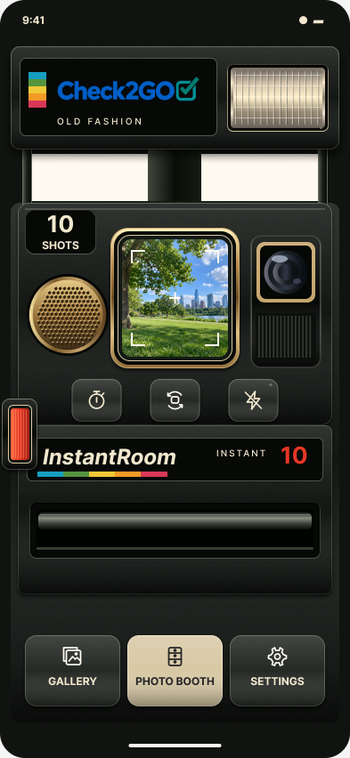

# Old Fashion — Design System 1.0

**Pending Design Approval** · 11 November 2026.

[Editable native Figma](https://www.figma.com/design/NxO84Y9jjY9AyBlFMeFvpC?node-id=7-4) · [Review prototype](https://www.figma.com/proto/NxO84Y9jjY9AyBlFMeFvpC/InstantRoom-Old-Fashion?node-id=16-4660&starting-point-node-id=16-4660)

This is a design handoff for the existing Android/iOS camera workflow. It does not implement the new surface in Compose or SwiftUI. Preserve saved style ID `OLD_FASION`; Old Fashion is the corrected public name. The shared [three-skin contract](../camera-skins.md) distinguishes runtime behavior from proposed design behavior and records the status of each family.

## Contents

- [Detailed developer handoff](Developer-Handoff.md): native layout, rendering, motion, semantics and remaining decisions.
- [Tokens](specs/tokens.json), [finish definitions](specs/finishes.json), [component inventory](specs/component-inventory.json) and [interaction states](specs/interaction-states.json).
- [Film geometry](specs/film-geometry.json), [responsive geometry](specs/responsive.json), [motion](specs/motion.json), [materials](specs/materials.json), [typography](specs/typography.json).
- [Contrast calculations](specs/contrast.json) and [design touch-target evidence](specs/target-audit.json). These are design checks, not native-device tests.
- [Mechanical control states](visuals/states.png), [secondary screens 1](visuals/review1.png) and [secondary screens 2](visuals/review2.png).
- [Asset inventory](specs/asset-inventory.json): original logo, six SVG icon masters, small matte texture, outlined caption specimen and companion Sol Kol OFL. No font binaries or sample preview photograph are added to runtime assets.

Figma contains 11 pages, 106 native component masters in 13 variant sets, 72 camera-control variants, six film geometries, four responsive camera layouts, secondary screen specimens and an ejection timeline. The full reference comparison stays in Figma; supplied camera-manufacturer reference photographs are not added to the public repository or application.

## Explicit adaptations and limits

Authentic blue/teal Check2GO replaces the concept's cream brand lettering. Original INSTANT 10 replaces a manufacturer model badge and unsupported autofocus claim. The edge shutter retains a 48×80 logical touch target. Surface grain and lighting are restrained for native rendering. The new style-level shutter red is a proposed visual override, not a rewrite of stored finish IDs.

Review physical realism, preview framing and immediate-versus-staged appearance selection before implementation. Denistina/Historic redistribution rights remain unverified. Real CameraX/AVFoundation behavior, sensors, performance, safe areas and accessibility need native-device acceptance after integration.
