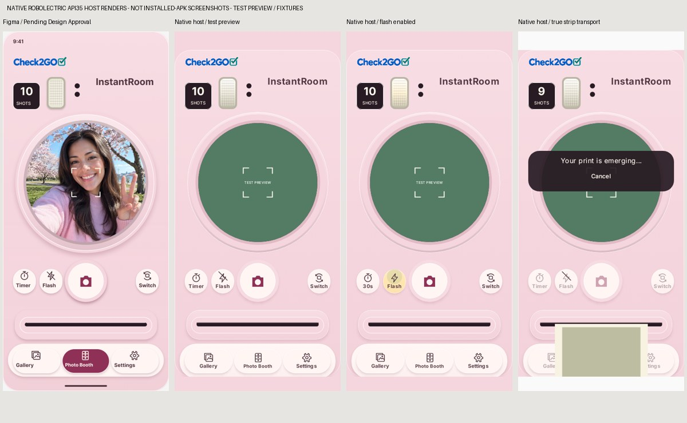
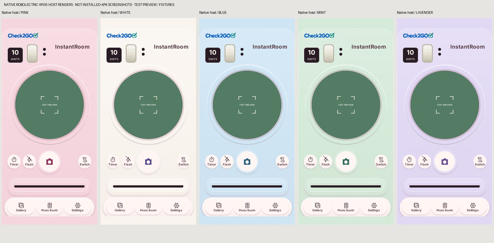
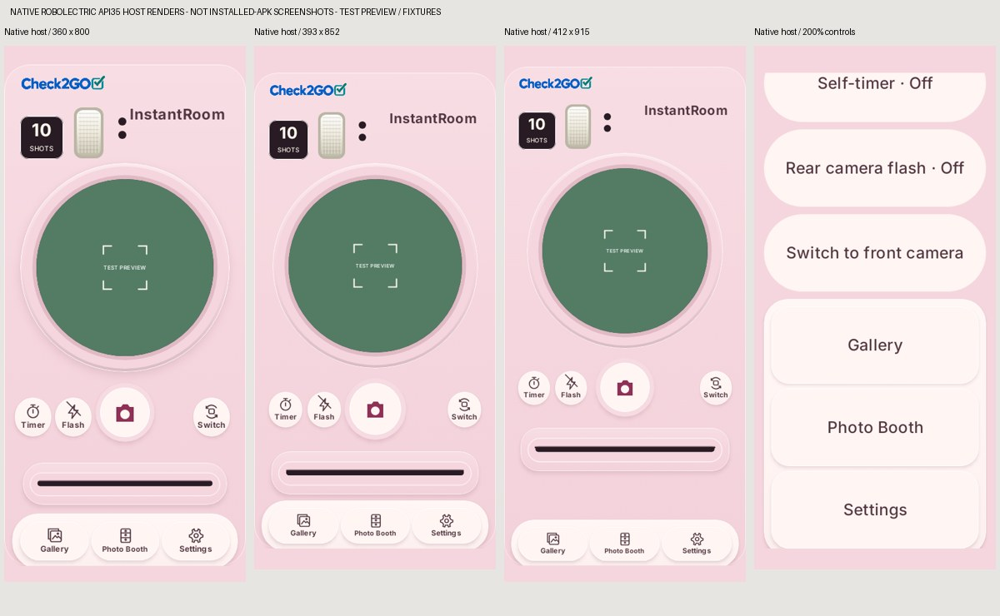
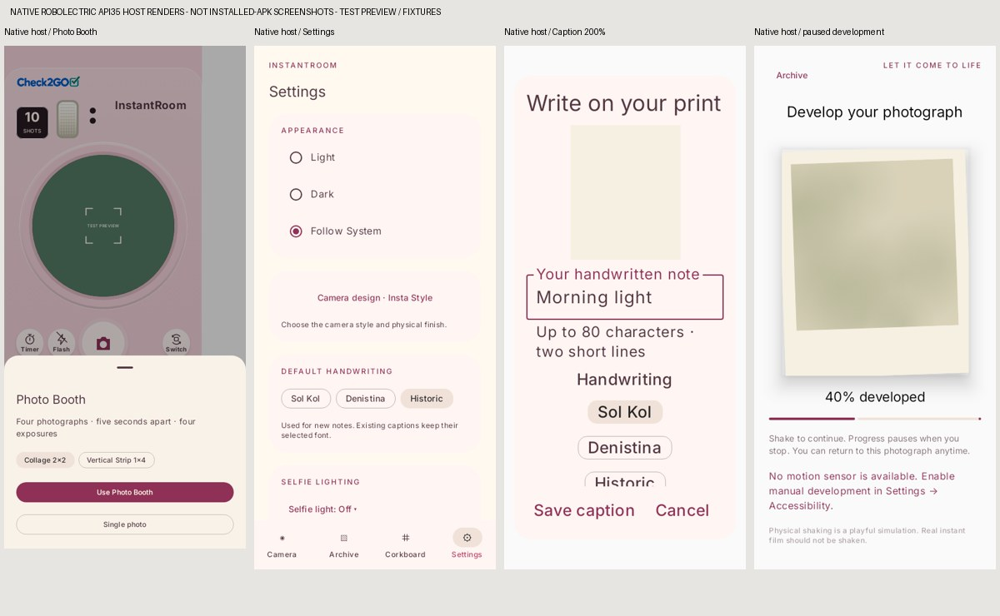
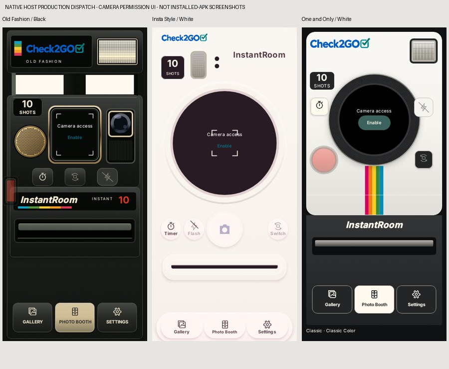

# Insta Style native review implementation

**Insta Style Design System 1.0 — Pending Product Design Approval.** This is an Android review implementation, not production design approval or a release.

Baseline: `bdf2c44612692c3b09b07d6093945da61b723d70`, verified remote development HEAD, containing merged PRs #6, #7, #8 and #9. Parent PR #5 is draft. Dedicated branch: `feature/android-insta-style-compose`, targeting `feature/android-camera-styles-flash`.

Version remains **0.5.0 (5)**, package `com.instantroom`, min API 26 / target and compile API 37. No permission, dependency, preference schema, Room schema or photographic processing change. Original handoffs and the approved Old Fashion/One and Only component files are preserved.

[Figma main](https://www.figma.com/design/vKttBpSwn9wfSg9aVB01NG?node-id=3-2) · [Prototype](https://www.figma.com/proto/vKttBpSwn9wfSg9aVB01NG/InstantRoom-Insta-Style?node-id=11-85&starting-point-node-id=11-85) · [Original handoff](../design-system/insta-style/README.md)

## Native integration

- `InstaStyleCamera.kt`: scoped physical tokens; satin molded body; authentic unchanged Check2GO logo; Inter wordmark; native counter; vertical Fresnel glass; circular optical rings and injected live aperture; ivory mechanical shutter; timer/flash/switch/selfie controls; roller slot and foreground lip; actual-state navigation tray; one decorative Camera Design preview; dark film cartridge with contact details.
- `InstaStyleLayout.kt`: geometry after actual system insets. Lens `min(width−48,334)`; aperture `diameter×262/310`; 100 dp shutter or compact 88 dp; 54×58 dp controls. Compact positions are independent, not a uniformly shrunk image. Large text uses scrolling, full-width 126 dp essential controls and stacked navigation. Smaller widths use the same essential-control route.
- `CameraScreen.kt`: replaces only the legacy Insta Style presentation and injects the already remembered CameraX PreviewView using COMPATIBLE/FILL_CENTER. Same lifecycle, lens selection, capture callbacks, timer, booth and lighting. Old Fashion and One and Only dispatches remain separate.
- `CameraStyling.kt`: existing selector calls one decorative Insta preview with a single correctly spaced finish caption. No second CameraX binding or preview controller is created.
- `InstantRoom.kt` / `Design.kt`: native camera navigation and readable system bars, with Insta-only warm app surfaces/ink or neutral Dark surfaces. Physical camera finishes remain independent of Light/Dark/System. Shared adaptive forms, sheets, menus, archive and corkboard retain their routes and state.
- `FilmLoadingScreen.kt`: Insta cartridge/contact and molded-door materials; existing CLOSED→OPEN→REMOVED→INSERTED→successful CLOSED state machine unchanged. No exposures added until successful replacement.
- `DevelopmentScreen.kt`: scoped Insta heading and wrapping completed-photo actions. FilmPrint rendering and physical shake-only development remain unchanged.
- `CaptionEditor.kt`: bounded uniform preview and wrapping actions; at large text, a bounded native dialog keeps Save/Cancel outside scrolling fields and applies real IME/safe-area padding. Save/render/font/persistence callbacks are shared with the existing standard-size dialog. No source image is overwritten by this UI change.
- `RoomViewModel.kt`: one additive transient `shutterFired` observation, set only by the existing camera capture-start callback. It supplies the decorative firing state without a new clock, sound, haptic or deduction. Existing appearance queue, cancellation, compatible-color fallback and capture/loading gate are unchanged.
- `generate_insta_style_assets.py`: reproducible seven original vector conversions and logo hash verification. Six 24 dp icons and original 36 dp shutter geometry; no sample selfie, manufacturer logo, flattened screen or new font binary.

All five finish/body/accent mappings and legacy shutter values remain unchanged. Exactly 13 style/finish pairs, one current finish preference, no per-family finish memory. Stored IDs `OLD_FASION`, `INSTA_STYLE`, `ONE_AND_ONLY` are retained; public Old Fashion spelling is correct.

## Motion and print transport

Shutter: 2 dp depression, 70 ms press / 110 ms release and native depth. Flash: persistent icon / 300 ms reversible state transition, domain-owned haptic; glass charging/firing uses capture state and camera-start event. Startup does not emit charging sound.

Ejection uses the existing 1800 ms domain progress and existing feedback owner. Paper aspect comes from the actual Classic/Go/Spectra/Round/Grid/Strip geometry. Transport uses unbounded physical height with viewport/mouth clipping: a 220 dp-wide strip is approximately 901 dp tall and is not squeezed into the gap above navigation. Large text has the same transport in its accessible ejection section. At completion the shared development view shows the full undeveloped print. Reduced motion changes only visual offset/depth, never capture/development/exposure timing.

## Secondary-screen adaptations

The relevant Insta materials and semantics apply to manual film loading, development, booth/countdown, archive, corkboard controls, caption editing, Settings and Camera Design. Actual photo/cork/paper colors are preserved. Existing native adaptive grids, forms, sheets, dialogs and system Back/navigation replace the Figma's static example rows, placeholder photographs and illustrated bars. The Figma input-simulation development button is not a production shortcut: only real shake input or the existing explicitly enabled accessibility step advances development. No secondary feature is deferred; device-specific IME, TalkBack and interaction acceptance remains pending.

## Automated and visual evidence

New checks cover native dispatch/injection, geometry, five finishes, callbacks, empty-film/unsupported hardware, actual booth selection, press/cancel, all six print shapes including uncompressed strip, responsive/large-text layouts, one preview and non-overlapping labels; twenty real app route assertions across five finishes; saved-navigation restoration and fresh preference/ViewModel reconstruction; secondary screens, 200% caption editing; camera-start feedback observation. Existing three-family/13-pair/busy policy/persistence/film/shake/export/migration/corkboard suites are included in the full run.

Commands from repository root:

```sh
cd android
./gradlew :core:test :app:testDebugUnitTest :app:lintDebug :app:assembleDebug :app:assembleDebugAndroidTest
cd ..
python3 -m unittest discover -s scripts -p 'test_*.py'
python3 android/scripts/generate_insta_style_assets.py --check
```

Screenshots in this report are **native Robolectric API 35 host renders**, not screenshots from an installed APK. Green TEST PREVIEW is injected only in tests; production uses CameraX. No connected emulator/device or KVM was available. Matrix: 360×800, 393×852, 412×915 dp; 100%/200% text; five finishes, selector, flash, booth sheet/countdown/ejection, secondary screens and unchanged Old Fashion/One and Only dispatches.

Native shadows, Fresnel/ring highlights, window-boundary shell bevels and touch feedback have minor rendering differences from Figma. The unselected Photo Booth tray in single-photo mode is an intentional correction: selected appearance follows actual mode. Large text uses the documented scrolling adaptation. These are review findings, not automatic product approval.

## Remaining physical and release acceptance

Real CameraX circular crop, front/rear rotation/mirroring and lifecycle; hardware flash, screen brightness/edge exposure; physical shake and haptics; ejection motor/audio/vibration; rendering performance; actual cutouts/gestures, TalkBack focus and keyboard; process death/recovery, APK upgrade/data preservation; gallery export and Instagram/Facebook handoff. Host saved-state/fresh-object tests do not establish OS process-death or device behavior.

Inter and Sol Kol licenses are retained. **Denistina/Historic redistribution rights remain unresolved for public release.** Pending appearance requests remain session-only until committed, as in PR #8. Do not merge or deploy before review.

## Executed local results — 12 November 2026

Complete committed-toolchain run: **74 core + 169 app + 6 Python = 249 unique tests passed; 0 failed, 0 skipped**. New coverage adds 6 core and 19 app tests. Repeated/focused runs are not counted twice. Twenty finish-retention route assertions are inside the five dedicated finish navigation tests, not twenty extra test cases. Saved navigation recreation and fresh preferences/ViewModels have separate tests.

Full Gradle checks, lint, debug and instrumentation APK assembly exit **0**. Local lint: **No issues found**. Instrumentation APK compiled, not device-executed. Asset checks passed. Existing legacy AGP/Kotlin DSL and Compose v1 test-rule deprecation notices remain; dependencies and detector settings were not changed.

Local environment: Temurin JDK 21.0.13+9, committed Gradle wrapper 9.5.0 (verified distribution hash), Android SDK 37 / Build Tools 37.0.0. The inherited proxy setting and incomplete system JRE were corrected only in the external local build launcher/tool installation. No project build workaround or toolchain downgrade. Delivery signing is performed by the existing AWS project with its retained protected key, rather than a disposable local debug identity.

Validation fixed an actual bounded-parent strip compression and a large-text caption-dialog intrinsic-layout failure. The new uniform transport and bounded IME-aware caption dialog are regression-tested. A shutter-press test now waits for the scroll container's accepted press event; the unchanged 70/110 ms visual timing starts from that event. The existing preview theme test captures the unmerged physical-body node, so the app-themed finish caption is not mistaken for physical camera paint. No test or lint rule is disabled.






