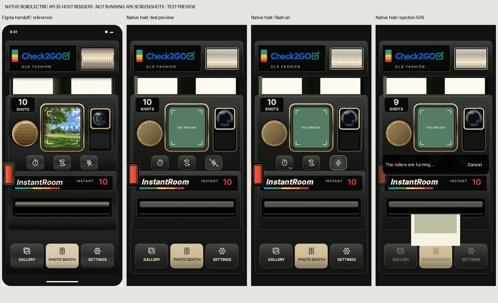
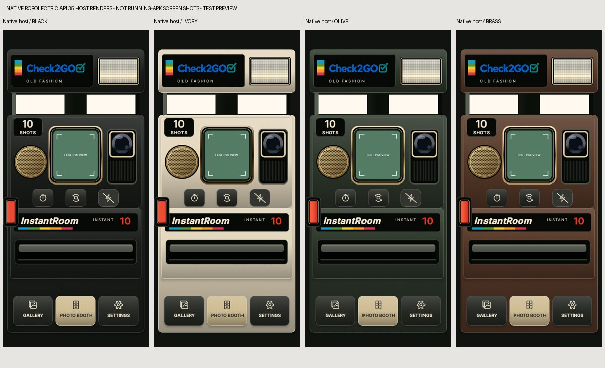
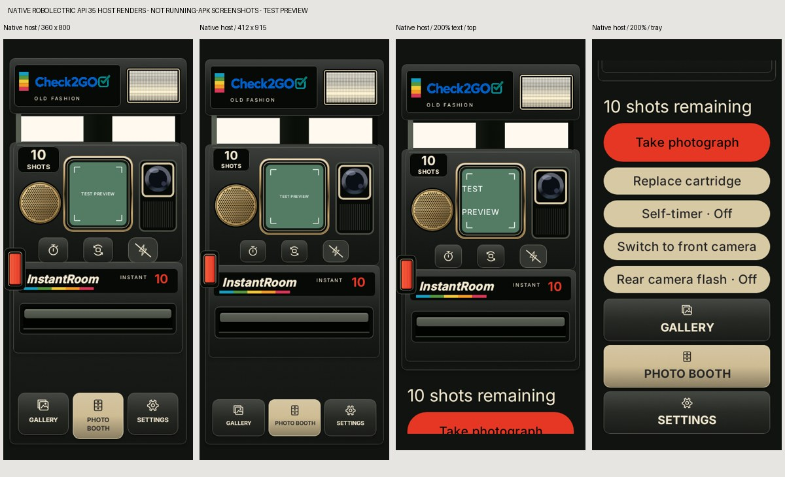
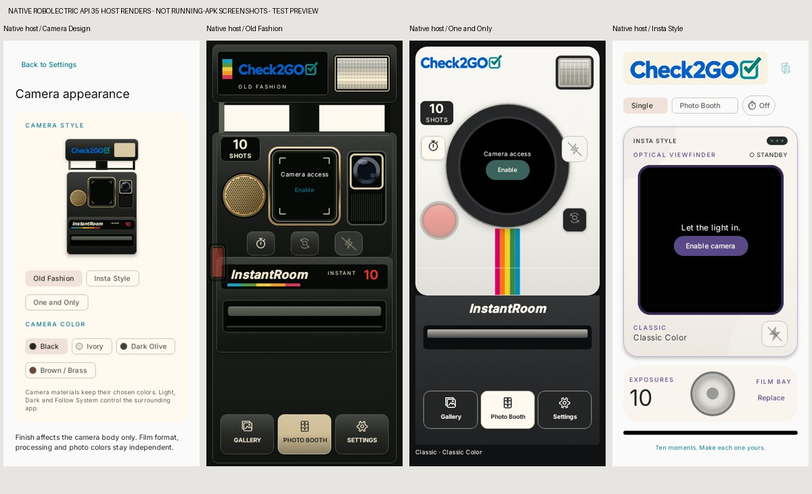

# Old Fashion native implementation

Implementation baseline: `d74cd67dd88811a3c1f2622cdb4202f0b4a44214`, containing merged design PRs #6 and #7. Branch: `feature/android-old-fashion-compose`; target: `feature/android-camera-styles-flash`. Version remains **0.5.0 (5)**, application ID `com.instantroom`, min API 26, target/compile API 37. No database migration, new permission, dependency, photo processing change or product release.

[Figma source](https://www.figma.com/design/NxO84Y9jjY9AyBlFMeFvpC?node-id=7-4) and the original `../design-system/old-fashion` handoff are preserved. The shared skin contract stays authoritative.

## Integration

- `OldFashionCamera.kt`: scoped physical tokens; raised flash and supports; authentic Check2GO logo; repeated matte texture; cached gold perforation path; real preview aperture; right optical recess; native counter, shutter, controls, compartment, roller and foreground paper lip; mechanical navigation; original SVG paths as VectorDrawables.
- `OldFashionLayout.kt`: geometry after actual consumed system insets, proportional decorative scaling, minimum touch sizes and large-text/narrow-screen tray. Public label is **Old Fashion**, stored `OLD_FASION` and all finish IDs remain compatible.
- `CameraScreen.kt`: dispatches Old Fashion to this skin and injects the existing CameraX `PreviewView`. Same controller, aspect-fill selection, capture coordinator, camera switching, timer, lighting and archive callbacks. `OneAndOnlyCamera.kt` is untouched; Insta Style retains its layout.
- `CameraSheets.kt`: presentation-only timer/selfie/Photo Booth choices. No second camera implementation or capture clock.
- `FlashToggle.kt`: optional scoped tint/size; original persistent bolt and 300 ms transition retained. Mechanical shutter depth uses 70 ms press / 110 ms release. Android reduced-motion settings affect presentation, never film/capture/development timing.
- `RoomViewModel.kt`: queues only appearance while capture/recomposition/charging/ejection or manual cartridge loading is unsafe. The latest compatible appearance applies after safe completion. Other preferences remain current; the queue has a clear cancel route. Applied choices persist immediately. The pending queue is session-only: abrupt process death retains the last committed appearance.
- `FilmLoadingScreen.kt`: existing manual state machine reports open/removal/insertion/closed phases; Old Fashion gets its native physical card. Closing still commits the cartridge before applying appearance. Existing ten-exposure ledger is unchanged.

No new audio/haptic events are emitted by decorative components. Capture/ejection/shake feedback continues through the existing coordinator. The paper uses the actual stored print aspect and existing 1800 ms ejection progress; the foreground lip clips the exiting print. Shake-only development is unchanged.

## Automated validation

Commands from repository root:

```sh
cd android
./gradlew :core:test :app:testDebugUnitTest :app:lintDebug :app:assembleDebug :app:assembleDebugAndroidTest
cd ..
python3 -m unittest discover -s scripts -p 'test_*.py'
python3 android/scripts/generate_old_fashion_icons.py --check
```

New coverage: seven core geometry/policy/motion tests; eight native UI tests; eight real Room/ViewModel switching integration tests; one manual loading UI integration test. Existing cartridge, timer, Photo Booth, shake, captions/export, migration, camera, theme, corkboard and One and Only tests remain in the full regression suite.

The UI matrix uses native Robolectric API 35 rendering at 360×800, 393×852 and 412×915 dp, 100% and 200% text, with explicitly supplied safe areas. Standard geometry verifies actual 48×80 dp shutter and 56×48 dp control bounds, preview injection, single callbacks, selected states, disabled behavior, decorative semantics, ejection proportions and all three dispatches. Settings persistence and busy switching use real Room/preferences with a fake capture port and deterministic clock. They are not camera hardware tests.

An initial lint detector exception occurred while sources were changing during analysis. Stable-source rerun succeeded without disabling any rule. Initial pixel-aspect assertions were corrected to allow one-pixel native rounding. The new close-loading UI test needed explicit Robolectric main-loop draining while waiting for Room's asynchronous completion; production loading logic did not need a timing workaround.

Final counts, signing evidence and APK checksum are recorded in the delivery verification report, rather than inferred from historical PR results.

## Visual acceptance

Screenshots under `screenshots/` are **native Compose host renders, not screenshots from an installed APK**. Green `TEST PREVIEW` is an injected UI-test double only. Production uses CameraX. No connected device, emulator or `/dev/kvm` was available in this environment.

Compared side by side with the committed Figma reference `../design-system/old-fashion/visuals/main-proposal.png`:

| Finding | Classification |
| --- | --- |
| Raised flash, supports, body, mesh, viewfinder, shutter, counter, slot and navigation follow canonical 393×852 coordinates after real insets | Matches geometry |
| CameraX center-cropped live preview replaces the Figma park photograph | Intentional native adaptation |
| Native gradient/shadow/texture compositing and Fresnel/rib sharpness differ slightly from Figma raster effects | Minor material difference |
| Black/Ivory/Olive/Brass body and trim follow existing finish mappings; ivory supports and optical blacks stay physical materials in either app theme | Matches finish contract |
| Large text keeps physical engravings fixed and adds a scrollable, full-width readable control tray and stacked navigation | Intentional accessibility adaptation |
| Countdown/status/cancel is a native overlay; ejection adds an actual undeveloped proportionate print | Intentional functional adaptation |
| Navigation uses native buttons/ripple/focus outline rather than flattened artwork | Intentional native adaptation |

No significant mismatch was found in the reviewed host-render matrix. Native host rendering does not establish device GPU performance, real system-bar/cutout behavior or TalkBack traversal acceptance.

## Physical-device acceptance still required

- Real CameraX preview, orientation, front mirroring, switching and lifecycle recovery.
- Rear flash, selfie screen brightness/exposure and edge illumination.
- Physical shake-only development, shake/ejection vibration and camera audio synchronization.
- Real device rendering performance, gestures/cutouts, 200% text scrolling and TalkBack focus order.
- Interrupted capture/loading/process recovery and upgrade installation against a previous signed build.
- Instagram/Facebook handoff and gallery export on installed third-party apps.

Do not merge or deploy before visual and physical-device review.






## Executed local results

2026-11-11, isolated source checkout; Temurin JDK 21.0.13, committed Gradle wrapper 9.5.0, Android platform 37 and Build Tools 37.0.0:

| Check | Passed | Failed | Skipped | Exit |
| --- | ---: | ---: | ---: | ---: |
| Core JUnit | 68 | 0 | 0 | 0 |
| App JUnit / native Compose / Room | 150 | 0 | 0 | 0 |
| Python upgrade helper | 6 | 0 | 0 | 0 |
| Lint | 0 errors; 2 dependency-update advisories for existing Lifecycle 2.10.0 pins | — | — | 0 |
| Debug + instrumentation APK assembly | Successful | — | — | 0 |
| Asset reproduction check | Successful | — | — | 0 |

224 unique tests passed; focused reruns are not added to this total. Instrumentation APK was compiled, not executed on a device. Existing AGP legacy-DSL/Kotlin-plugin and Compose v1 test-rule deprecation notices remain; no detector is suppressed. Local debug signing is disposable and is not the upgrade-compatible delivery certificate. The final AWS build reuses the existing protected development key without exporting it.
